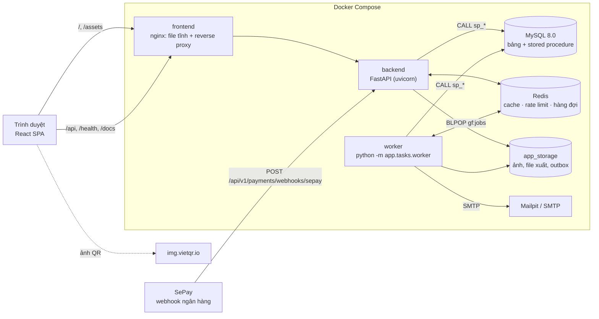
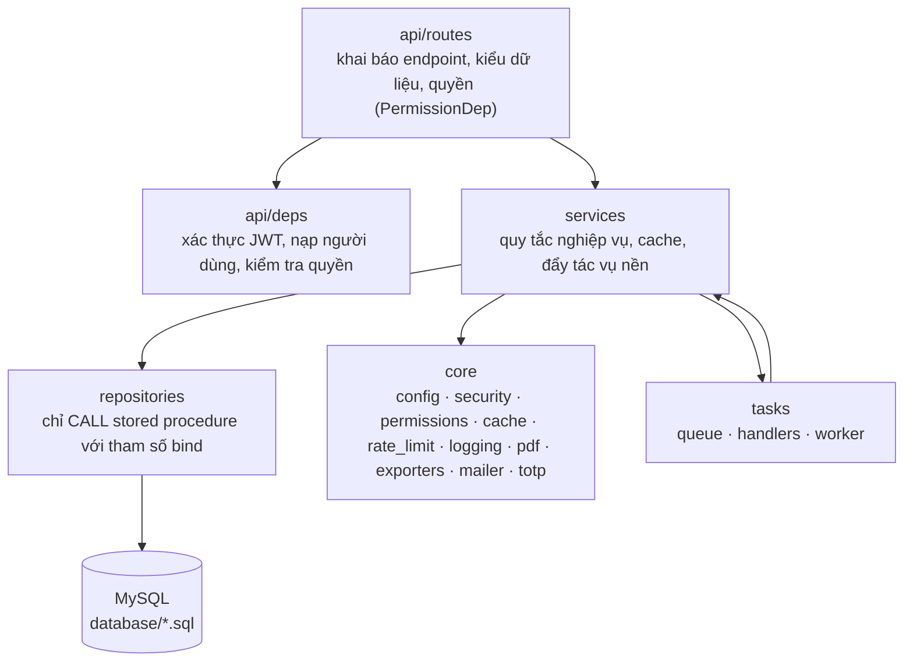
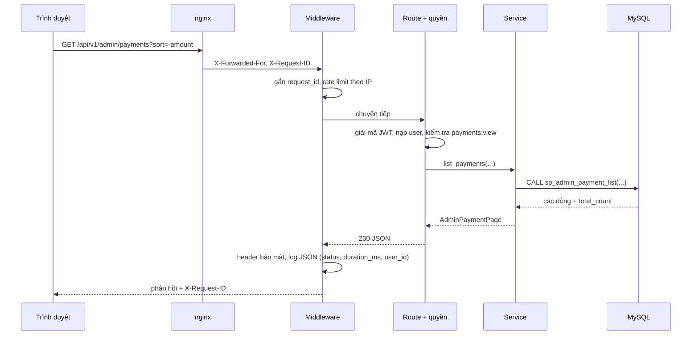
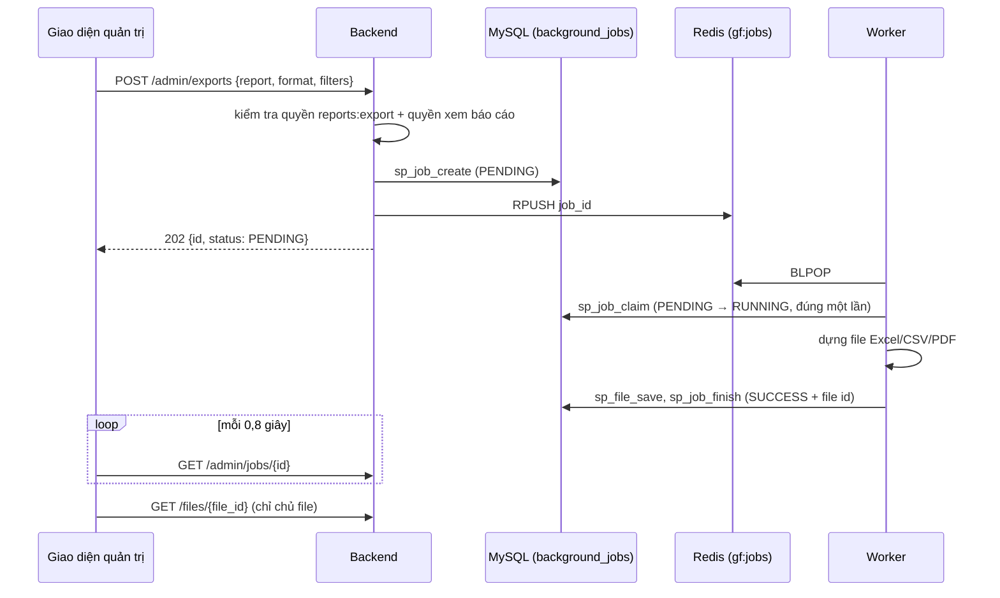
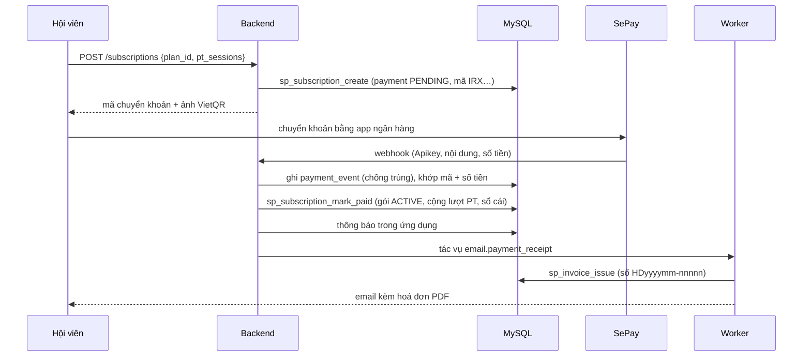
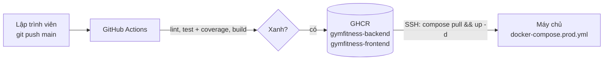

# KIẾN TRÚC HỆ THỐNG IRONIX FITNESS

## 1. Tổng quan thành phần

| Thành phần | Vai trò |
| --- | --- |
| `frontend` | Phục vụ SPA đã build, chuyển `/api`, `/health`, `/docs` sang backend, gắn header bảo mật |
| `backend` | REST API, kiểm tra quyền, nghiệp vụ, gọi stored procedure, đẩy tác vụ nền |
| `worker` | Chạy tác vụ nền: gửi email, dựng file Excel/CSV/PDF |
| `mysql` | Nguồn dữ liệu duy nhất; mọi truy vấn là stored procedure có transaction |
| `redis` | Cache danh mục/báo cáo, bộ đếm rate limit, hàng đợi id tác vụ |
| `mailpit` | Hộp thư giả lập khi dev/demo (production dùng SMTP thật) |

## 2. Phân lớp backend

- **Không có câu SQL trong Python.** `repositories/procedures.py` là chỗ duy nhất tạo lệnh `CALL`, tên procedure là hằng số trong code, giá trị luôn là tham số bind (chống SQL injection).
- **Transaction nằm trong procedure.** Các nghiệp vụ tiền và lượt PT khoá dòng (`SELECT … FOR UPDATE`) và ghi sổ cái trong cùng transaction.
- **Lỗi thống nhất.** Mọi lỗi trả `{"error": {"code", "message", "details"}}`; procedure trả `error_code` để service đổi sang HTTP status.

## 3. Vòng đời một request

## 4. Hàng đợi tác vụ

Không có Redis: API chạy tác vụ trong thread pool của chính nó. Worker quét lại tác vụ
`PENDING` quá 2 phút để không mất việc khi Redis hoặc worker khởi động lại (ADR-020).

## 5. Thanh toán tự động

## 6. Bảo mật

| Mối đe doạ | Biện pháp |
| --- | --- |
| Dò mật khẩu | Khoá tài khoản sau 5 lần sai, rate limit 10 req/phút/IP cho đăng nhập, xác thực 2 bước tuỳ chọn |
| Lộ mật khẩu/token | PBKDF2 600.000 vòng; token đặt lại chỉ lưu SHA-256; khoá TOTP mã hoá Fernet |
| Giả mạo phiên | JWT HS256 ký bằng secret ≥ 32 ký tự; token mục đích riêng (`purpose`) không dùng làm phiên |
| SQL injection | Chỉ stored procedure + tham số bind |
| XSS | React escape mặc định; không chèn HTML thô; SVG/QR hiển thị qua ``; CSP cho `/files` |
| CSRF | Không dùng cookie phiên; token gửi bằng header `Authorization` |
| Leo thang quyền | Kiểm tra quyền ở từng route + luật theo dữ liệu trong service (Manager chỉ quản lý hội viên) |
| Truy cập file người khác | `/files/{id}` chỉ trả cho chủ file; hoá đơn kiểm tra chủ giao dịch |
| Lạm dụng API | Rate limit 300 req/phút/IP; webhook ngân hàng xác thực API key |
| Clickjacking, MIME sniffing | `X-Frame-Options: DENY`, `X-Content-Type-Options: nosniff` |

## 7. Cache

| Nhóm | Dữ liệu | TTL | Vô hiệu khi |
| --- | --- | --- | --- |
| `catalog` | Gói tập công khai, sản phẩm, danh sách PT | 300 s | Sửa gói/sản phẩm/tài khoản PT, PT lưu lịch, nhập sản phẩm |
| `reports` | Báo cáo doanh thu, tăng trưởng hội viên | 120 s | Có giao dịch thành công, tạo/xoá tài khoản |

Khoá có dạng `gf:cache:<nhóm>:<phiên bản>:<khoá>`; vô hiệu một nhóm chỉ cần tăng
`gf:cache:ver:<nhóm>` (ADR-021).

## 8. Log và giám sát

- Mỗi request ghi một dòng log `app.access` gồm `method`, `path`, `status`, `duration_ms`, `client_ip`, `user_id`, `request_id`.
- `request_id` lấy từ header `X-Request-ID` (nginx sinh) hoặc tự tạo, trả lại trong phản hồi và gắn vào mọi log trong request.
- `LOG_FORMAT=json` cho production (đọc được bằng Loki/ELK/CloudWatch), `text` cho dev.
- `/health/live`: tiến trình sống. `/health/ready`: MySQL kết nối được (bắt buộc) và trạng thái Redis (`up`/`down`/`disabled`). Docker dùng làm healthcheck.

## 9. Triển khai

Chi tiết: [DEPLOYMENT.md](DEPLOYMENT.md).
