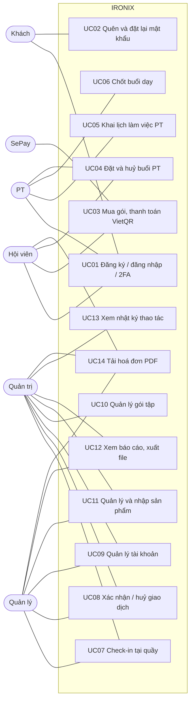

# ĐẶC TẢ YÊU CẦU PHẦN MỀM (SRS) — IRONIX FITNESS

Phiên bản 1.0 · Hệ thống quản lý phòng tập Gym/Yoga

## 1. Giới thiệu

### 1.1. Mục đích

Tài liệu mô tả đầy đủ yêu cầu chức năng và phi chức năng của hệ thống IRONIX Fitness, làm căn
cứ cho thiết kế, kiểm thử, nghiệm thu và bảo trì. Đối tượng đọc: nhóm phát triển, giảng viên
đánh giá, người vận hành phòng tập.

### 1.2. Phạm vi

IRONIX là ứng dụng web cho một chuỗi phòng tập, gồm:

- Trang công khai: giới thiệu, gói tập, cửa hàng.
- Khu hội viên: đăng ký và thanh toán gói, lịch tập, đặt huấn luyện viên (PT), hồ sơ, bảo mật tài khoản.
- Khu PT: lịch làm việc, buổi dạy.
- Khu quản trị: tài khoản, gói tập, cửa hàng, giao dịch, ra vào, báo cáo, nhật ký thao tác, xuất/nhập dữ liệu.

Ngoài phạm vi phiên bản này: giỏ hàng và đặt hàng trực tuyến, lớp học nhóm, thiết bị/bảo trì
(đã có bảng dữ liệu, chưa có màn hình), ứng dụng di động, đăng nhập bằng mạng xã hội.

### 1.3. Thuật ngữ

| Thuật ngữ | Nghĩa |
| --- | --- |
| Gói hội viên | Quyền tập Gym hoặc Yoga trong một thời hạn (tháng/năm/ngày) |
| Lượt PT | Một buổi tập 60 phút với huấn luyện viên đã thanh toán |
| Ô trống | Khung 60 phút trong lịch làm việc của PT chưa có ai đặt |
| VietQR | Mã QR chuyển khoản liên ngân hàng Việt Nam |
| Webhook SePay | Dịch vụ báo có tiền vào tài khoản ngân hàng cho backend |
| RBAC | Phân quyền theo vai trò |
| TOTP / 2FA | Mã một lần theo thời gian / xác thực 2 bước |

### 1.4. Tài liệu tham chiếu

[ERD.md](ERD.md) · [USER_FLOWS.md](USER_FLOWS.md) · [ARCHITECTURE.md](ARCHITECTURE.md) ·
[DECISIONS.md](DECISIONS.md) · Swagger tại `/docs` · [Postman collection](postman/GymFitness.postman_collection.json)

## 2. Mô tả tổng quan

### 2.1. Tác nhân

| Tác nhân | Mô tả |
| --- | --- |
| Khách | Chưa đăng nhập: xem trang chủ, gói tập, sản phẩm; đăng ký; quên mật khẩu |
| Hội viên (`USER`) | Mua gói, thanh toán, xem lịch, mua và đặt PT, quản lý hồ sơ |
| Huấn luyện viên (`PT`) | Khai lịch làm việc, xem và chốt buổi dạy, huỷ buổi kèm lý do |
| Quản lý (`MANAGER`) | Vận hành hằng ngày: hội viên, check-in, thu tiền, cửa hàng, báo cáo |
| Quản trị (`ADMIN`) | Toàn quyền, gồm tài khoản nhân sự, gói tập, huỷ giao dịch, nhật ký |
| Ngân hàng / SePay | Hệ thống ngoài gọi webhook khi có tiền vào |
| Máy chủ SMTP | Hệ thống ngoài nhận email cần gửi |

### 2.2. Ràng buộc

- Database MySQL 8.0; mọi truy vấn của ứng dụng nằm trong stored procedure.
- Backend Python 3.12 / FastAPI; frontend React chạy trên trình duyệt hiện đại.
- Thời gian lưu UTC, hiển thị theo giờ phòng tập (UTC+7).
- Tiền tệ VND, lưu kiểu `NUMERIC(14,2)`.

### 2.3. Giả định

- Mỗi hội viên có một tài khoản email riêng.
- Phòng tập có tài khoản ngân hàng đăng ký SePay để nhận webhook (không có thì quản trị xác nhận thu tiền thủ công).

## 3. Yêu cầu chức năng

Mức ưu tiên: **B** = bắt buộc, **N** = nên có, **T** = tuỳ chọn. Mọi yêu cầu dưới đây đã được hiện thực.

### 3.1. Tài khoản và xác thực

| Mã | Yêu cầu | Ưu tiên |
| --- | --- | --- |
| FR-AUTH-01 | Khách đăng ký bằng họ tên, email, số điện thoại (tuỳ chọn), mật khẩu ≥ 8 ký tự; email/số điện thoại không trùng | B |
| FR-AUTH-02 | Đăng nhập bằng email hoặc tên đăng nhập; trả JWT có hạn 30 phút | B |
| FR-AUTH-03 | Sai mật khẩu 5 lần liên tiếp thì khoá tạm 15 phút | B |
| FR-AUTH-04 | Quên mật khẩu: gửi email liên kết đặt lại; không tiết lộ email có tồn tại | B |
| FR-AUTH-05 | Liên kết đặt lại dùng một lần, hết hạn sau 30 phút | B |
| FR-AUTH-06 | Xác thực 2 bước TOTP: bật bằng mã QR, tắt cần mật khẩu + mã | T |
| FR-AUTH-07 | Tài khoản bị khoá/ngưng không đăng nhập được | B |

### 3.2. Phân quyền

| Mã | Yêu cầu | Ưu tiên |
| --- | --- | --- |
| FR-RBAC-01 | Bốn vai trò `ADMIN`, `MANAGER`, `USER`, `PT` | B |
| FR-RBAC-02 | Mỗi màn hình quản trị gắn với một quyền; tài khoản không có quyền không thấy màn hình | B |
| FR-RBAC-03 | Mỗi hành động (tạo, sửa, xoá, xác nhận, huỷ, xuất) kiểm tra quyền riêng ở backend | B |
| FR-RBAC-04 | Manager chỉ quản lý được tài khoản hội viên, không quản lý tài khoản nhân sự | B |

### 3.3. Gói hội viên và thanh toán

| Mã | Yêu cầu | Ưu tiên |
| --- | --- | --- |
| FR-PAY-01 | Hội viên chọn gói (tháng/năm hoặc theo ngày) và mua kèm lượt PT trong một giao dịch | B |
| FR-PAY-02 | Hiển thị VietQR với mã chuyển khoản duy nhất, hết hạn sau 30 phút | B |
| FR-PAY-03 | Webhook SePay xác thực API key, khớp mã và số tiền rồi kích hoạt quyền lợi | B |
| FR-PAY-04 | Quản trị/quản lý xác nhận thu tiền thủ công; quản trị huỷ giao dịch đang chờ | B |
| FR-PAY-05 | Mỗi giao dịch đã thu có hoá đơn PDF; email biên nhận đính kèm hoá đơn | B |
| FR-PAY-06 | Gia hạn khi gói cùng loại hình còn hạn: gói mới nối tiếp sau ngày hết hạn | B |
| FR-PAY-07 | Gói quá hạn chuyển `EXPIRED`; nhắc gia hạn trước 7/3/1 ngày (in-app + email) | B |

### 3.4. Huấn luyện viên và buổi PT

| Mã | Yêu cầu | Ưu tiên |
| --- | --- | --- |
| FR-PT-01 | PT khai lịch làm việc hằng tuần và lịch nghỉ đột xuất | B |
| FR-PT-02 | Hội viên thấy ô 60 phút còn trống trong 14 ngày tới của PT có chuyên môn khớp gói | B |
| FR-PT-03 | Đặt ô trống là xác nhận ngay và giữ 1 lượt PT | B |
| FR-PT-04 | PT huỷ trước giờ phải có lý do, luôn hoàn lượt; hội viên huỷ sớm ≥ 12 giờ được hoàn lượt | B |
| FR-PT-05 | PT chốt hoàn thành hoặc vắng mặt sau giờ bắt đầu; lượt chuyển sang đã dùng | B |
| FR-PT-06 | Thông báo trong ứng dụng và email cho bên còn lại khi buổi bị huỷ | B |
| FR-PT-07 | Buổi kết thúc quá 24 giờ chưa chốt được tự ghi hoàn thành | N |
| FR-PT-08 | Khoá tài khoản PT/hội viên tự huỷ buổi chưa bắt đầu và hoàn lượt; PT bị khoá không đặt được | B |
| FR-PT-09 | Mọi lượt PT bán cùng một giá, giao diện đọc giá từ API | B |

### 3.5. Quản trị

| Mã | Yêu cầu | Ưu tiên |
| --- | --- | --- |
| FR-ADM-01 | Tổng quan: hội viên, hội viên còn gói, doanh thu tháng, giao dịch chờ | B |
| FR-ADM-02 | Quản lý tài khoản: tìm kiếm, lọc vai trò/trạng thái, sắp xếp, phân trang, tạo, sửa, đặt lại mật khẩu, xoá mềm | B |
| FR-ADM-03 | Quản lý gói tập: thêm, sửa, ngừng bán, xoá mềm; chống ghi đè bằng phiên bản | B |
| FR-ADM-04 | Quản lý sản phẩm: CRUD, tồn kho ghi sổ kho, nhập từ Excel/CSV theo SKU | B |
| FR-ADM-05 | Giao dịch: tìm, lọc trạng thái/loại/khoảng ngày, sắp xếp, tổng đã thu | B |
| FR-ADM-06 | Ra vào: check-in tại quầy, check-out, lịch sử theo khoảng ngày | B |
| FR-ADM-07 | Báo cáo doanh thu và tăng trưởng hội viên theo tuần/tháng/quý/năm | B |
| FR-ADM-08 | Nhật ký thao tác: ai làm gì, lúc nào, dữ liệu trước/sau | B |
| FR-ADM-09 | Xuất mọi danh sách và báo cáo ra Excel, CSV, PDF, chạy nền | B |

### 3.6. Thông báo

| Mã | Yêu cầu | Ưu tiên |
| --- | --- | --- |
| FR-NOTI-01 | Thông báo trong ứng dụng: đếm chưa đọc, đánh dấu đã đọc | B |
| FR-NOTI-02 | Email: đặt lại mật khẩu, biên nhận thanh toán, huỷ buổi PT — gửi qua hàng đợi tác vụ | B |

## 4. Use case

| Mã | Tên | Tác nhân | Điều kiện trước | Kết quả |
| --- | --- | --- | --- | --- |
| UC01 | Đăng ký / đăng nhập / 2FA | Khách, mọi vai trò | — | Có phiên đăng nhập JWT |
| UC02 | Quên và đặt lại mật khẩu | Khách | Email đã đăng ký | Mật khẩu mới, tài khoản mở khoá |
| UC03 | Mua gói, thanh toán VietQR | Hội viên, SePay | Đã đăng nhập | Gói `ACTIVE`, hoá đơn gửi email |
| UC04 | Đặt và huỷ buổi PT | Hội viên, PT | Gói còn hạn, còn lượt PT | Buổi `ACCEPTED` / `CANCELLED`, lượt cập nhật |
| UC05 | Khai lịch làm việc | PT | — | Ô trống hiển thị cho hội viên |
| UC06 | Chốt buổi dạy | PT | Đã tới giờ bắt đầu | `COMPLETED`/`NO_SHOW`, trừ lượt |
| UC07 | Check-in tại quầy | Quản lý, Quản trị | Hội viên còn gói | Lượt ra vào được ghi |
| UC08 | Xác nhận / huỷ giao dịch | Quản lý (xác nhận), Quản trị | Giao dịch `PENDING` | `PAID` (kích hoạt quyền lợi) / `VOID` |
| UC09 | Quản lý tài khoản | Quản lý (hội viên), Quản trị | — | Tài khoản tạo/sửa/khoá/xoá mềm, có audit log |
| UC10 | Quản lý gói tập | Quản trị | — | Gói cập nhật, có audit log, chống ghi đè |
| UC11 | Quản lý và nhập sản phẩm | Quản lý, Quản trị | — | Sản phẩm cập nhật, báo lỗi theo dòng khi nhập |
| UC12 | Báo cáo, xuất file | Quản lý, Quản trị | — | File Excel/CSV/PDF tải về |
| UC13 | Nhật ký thao tác | Quản trị | — | Danh sách thao tác kèm dữ liệu trước/sau |
| UC14 | Tải hoá đơn PDF | Hội viên (của mình), nhân sự | Giao dịch `PAID` | File PDF hoá đơn |

Luồng chi tiết từng use case: [USER_FLOWS.md](USER_FLOWS.md).

## 5. Yêu cầu phi chức năng

| Mã | Nhóm | Yêu cầu | Cách đáp ứng |
| --- | --- | --- | --- |
| NFR-SEC-01 | Bảo mật | Mật khẩu không lưu dạng rõ | PBKDF2-SHA256 600.000 vòng |
| NFR-SEC-02 | Bảo mật | Chống SQL injection | Chỉ gọi stored procedure với tham số bind |
| NFR-SEC-03 | Bảo mật | Chống XSS | React tự escape; ảnh/SVG hiển thị qua ``; header `X-Content-Type-Options`, CSP cho file |
| NFR-SEC-04 | Bảo mật | Chống CSRF | Token gửi bằng header `Authorization`, không dùng cookie phiên |
| NFR-SEC-05 | Bảo mật | Giới hạn tần suất | 10 req/phút cho đăng nhập/đăng ký/quên mật khẩu, 300 req/phút cho API |
| NFR-SEC-06 | Bảo mật | CORS chỉ cho phép origin cấu hình | `FRONTEND_ORIGINS` |
| NFR-SEC-07 | Bảo mật | Secret không nằm trong mã nguồn | `.env`; từ chối `JWT_SECRET_KEY` yếu ngoài môi trường dev |
| NFR-PERF-01 | Hiệu năng | Danh mục công khai và báo cáo phản hồi nhanh khi tải cao | Cache Redis 120–300 giây, vô hiệu khi dữ liệu đổi |
| NFR-PERF-02 | Hiệu năng | Tác vụ lâu không chặn request | Hàng đợi tác vụ + worker |
| NFR-PERF-03 | Hiệu năng | Danh sách lớn | Phân trang ở database, index theo cột lọc |
| NFR-REL-01 | Tin cậy | Tiền và lượt PT không sai lệch | Transaction + khoá dòng trong procedure, sổ cái bất biến |
| NFR-REL-02 | Tin cậy | Không ghi đè dữ liệu của người khác | `row_version` (khoá lạc quan) |
| NFR-REL-03 | Tin cậy | Dữ liệu lịch sử được giữ | Soft-delete, audit log |
| NFR-OPS-01 | Vận hành | Log có cấu trúc | JSON một dòng, có `request_id`, `user_id`, thời gian xử lý |
| NFR-OPS-02 | Vận hành | Kiểm tra sức khoẻ | `/health/live`, `/health/ready` (MySQL + Redis) |
| NFR-OPS-03 | Vận hành | Triển khai lặp lại được | Docker Compose, CI/CD GitHub Actions |
| NFR-QA-01 | Chất lượng | Độ phủ test ≥ 30–40% | Unit + integration test, CI chặn khi < 80% (hiện ≈ 93%) |
| NFR-UX-01 | Khả dụng | Giao diện tiếng Việt, hiển thị giờ Việt Nam | Toàn bộ nhãn, thông báo lỗi và PDF bằng tiếng Việt |

## 6. Giao diện ngoài

| Hệ thống | Giao tiếp |
| --- | --- |
| VietQR (img.vietqr.io) | Ảnh QR chuyển khoản dựng từ mã ngân hàng, số tài khoản, số tiền, nội dung |
| SePay | `POST /api/v1/payments/webhooks/sepay`, header `Authorization: Apikey <key>` |
| SMTP | Gửi email (STARTTLS tuỳ chọn); dev/demo dùng Mailpit |
| Ứng dụng Authenticator | Chuẩn TOTP RFC 6238 qua URI `otpauth://` |

## 7. Ma trận đáp ứng yêu cầu bài tập lớn

| Yêu cầu | Đáp ứng ở |
| --- | --- |
| Đăng ký/đăng nhập, JWT, đặt lại mật khẩu, 2FA | FR-AUTH-01…07 · `app/services/auth.py` |
| RBAC ≥ 3 vai trò, theo màn hình & hành động | FR-RBAC · `app/core/permissions.py`, `pages/Admin.jsx` |
| CRUD + tìm kiếm, lọc, sắp xếp, phân trang | FR-ADM-02…06 · `database/08_admin.sql`, `09_admin_shop.sql` |
| Nhập/xuất Excel/CSV, xuất PDF | FR-ADM-04, FR-ADM-09, FR-PAY-05 · `app/core/exporters.py`, `pdf.py` |
| Audit log, soft-delete, versioning | FR-ADM-08, NFR-REL-02/03 · ADR-022 |
| Thông báo email/in-app, hàng đợi job | FR-NOTI · `app/tasks/` · ADR-020 |
| OpenAPI/Swagger, Postman | `/docs`, `docs/postman/` |
| Unit + integration test, coverage | `backend/tests/` · NFR-QA-01 |
| Docker + hướng dẫn triển khai, CI/CD | `docker-compose*.yml`, `docs/DEPLOYMENT.md`, `.github/workflows/ci.yml` |
| Chống SQLi/XSS/CSRF, rate limit, CORS, cache Redis | NFR-SEC, NFR-PERF · ADR-021 |
| Seed ≥ 2.000 bản ghi | `database/10_seed_demo.sql` (≈ 11.000 bản ghi) |
| Logging có cấu trúc, health check | NFR-OPS-01/02 · `app/core/logging.py` |
| SRS, ERD, use case/flow, sơ đồ kiến trúc | Tài liệu này, `ERD.md`, `USER_FLOWS.md`, `ARCHITECTURE.md` |
| Hướng dẫn cài đặt, sử dụng, video demo | `INSTALL.md`, `USER_GUIDE.md`, `DEMO_SCRIPT.md` |
